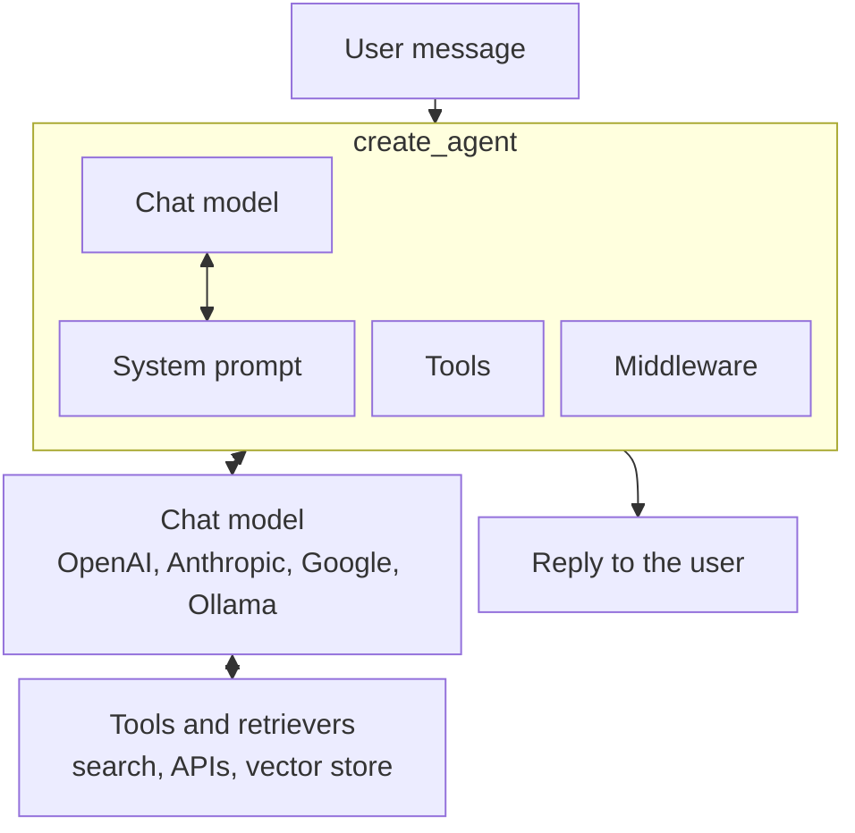
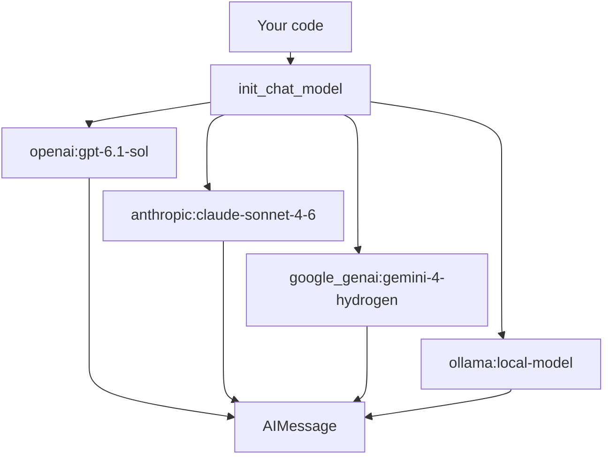
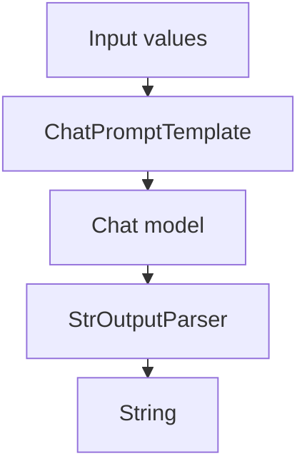
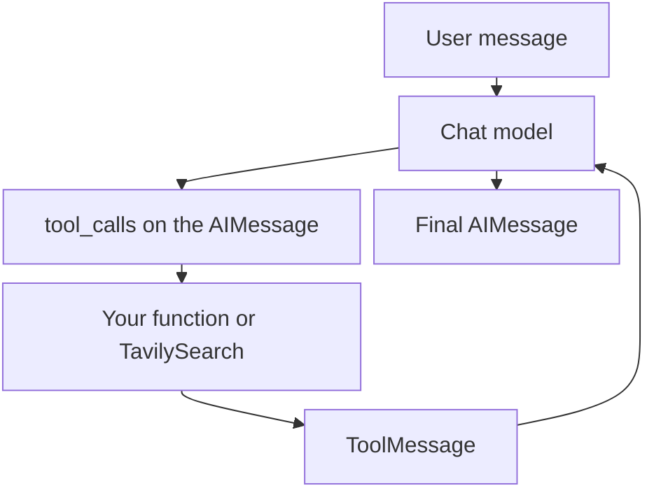
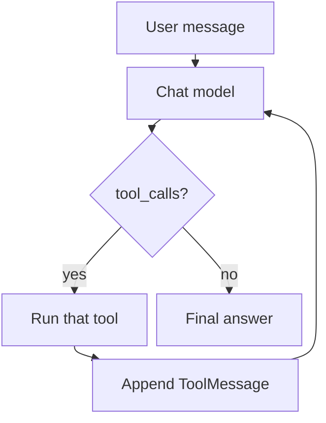
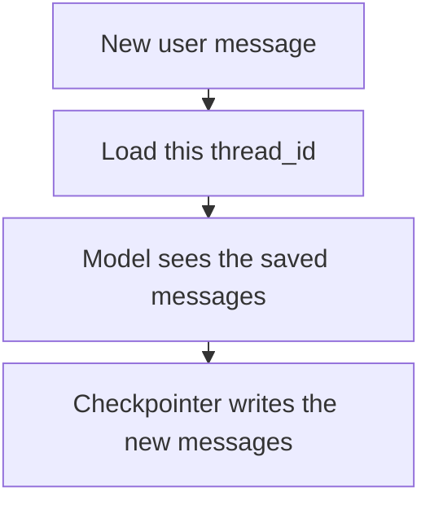
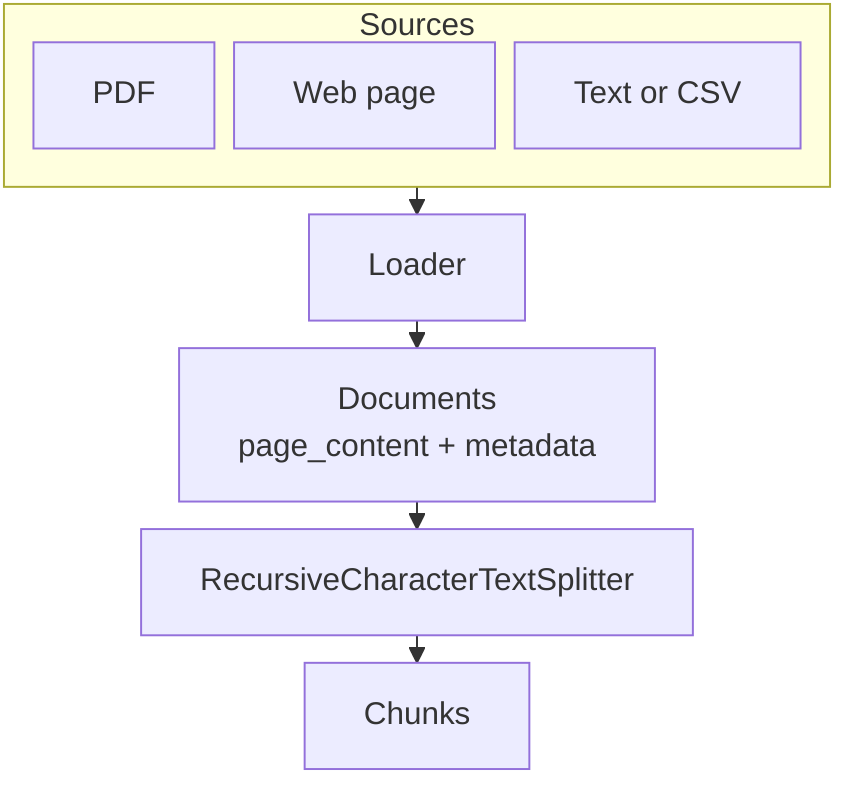
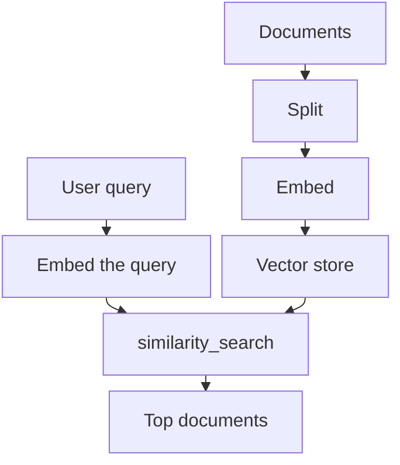
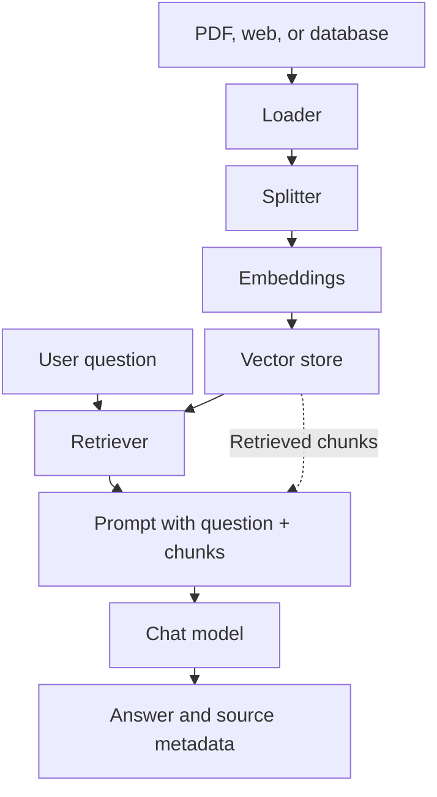

# LangChain

## Developer study notes

These notes follow the current LangChain Python docs: [LangChain overview](https://docs.langchain.com/oss/python/langchain/overview). LangChain v1 is built around `create_agent` and a small set of shared building blocks: chat models, messages, tools, and retrievers.

Model ids in the examples are the sample ids used in those docs (`openai:gpt-6.1-sol`, `anthropic:claude-sonnet-4-6`, `google_genai:gemini-4-hydrogen`). Provider packages pass the id through to the provider, so a newer id works without a LangChain upgrade. If a call rejects the id, replace it with one from that provider's current model list and keep the `provider:model` form.

Older tutorials use `LLMChain`, `RetrievalQA`, `initialize_agent`, and `ConversationBufferMemory`. Those names moved to `langchain-classic`. The last section maps each one to the current API.

## 1. What LangChain is

LangChain is an open-source framework for applications that call large language models. It gives one interface for chat models, tools, document loading, splitting, embeddings, and vector search, so the same application can switch providers.

The v1 surface area is small on purpose:

- A **chat model** turns messages into a new message.
- A **tool** is a function the model may call.
- An **agent** is a model calling tools in a loop until the task is done. `create_agent` is the harness around that loop: the prompt, the tools, and optional middleware.
- A **retriever** returns documents relevant to a query. Retrieval-augmented generation (RAG) puts those documents into the prompt before the model answers.

LangChain has JavaScript libraries as well. These notes use Python, which requires Python 3.10 or newer.

### Why use it

- One calling style for OpenAI, Anthropic, Google, Ollama, and other providers.
- Tools, retrievers, and message history without writing the loop yourself.
- Document loaders, text splitters, and vector stores behind a shared interface.
- LangSmith tracing for token use, tool calls, and failed runs.

### High-level architecture



## 2. Install and configure

### Packages

```bash
python -m venv langchain_env
source langchain_env/bin/activate

pip install -U langchain
pip install -U langchain-openai langchain-anthropic langchain-google-genai
pip install -U langchain-ollama langchain-community langchain-text-splitters
pip install -U langchain-tavily langchain-chroma faiss-cpu pypdf python-dotenv
```

Install only the provider packages you call. `langchain` does not bundle OpenAI, Anthropic, or Google.

### Environment variables

Create a `.env` file in the project root. Leave secrets out of source code.

```text
OPENAI_API_KEY=your_openai_key
ANTHROPIC_API_KEY=your_anthropic_key
GOOGLE_API_KEY=your_google_key
TAVILY_API_KEY=your_tavily_key
LANGSMITH_TRACING=true
LANGSMITH_API_KEY=your_langsmith_key
LANGSMITH_PROJECT=langchain-study
```

`LANGSMITH_TRACING` is the current tracing switch. Older tutorials set `LANGCHAIN_TRACING_V2=true` and `LANGCHAIN_API_KEY`.

```python
from dotenv import load_dotenv

load_dotenv()
```

`init_chat_model` reads the provider key from the environment. Do not print the key.

### Confirm the install

```python
from langchain.chat_models import init_chat_model

model = init_chat_model("openai:gpt-6.1-sol", temperature=0)
print(model.invoke("Reply with one word: ready").content)
```

### Project layout

```text
langchain-project/
|-- .env
|-- app.py
|-- requirements.txt
|-- data/
|   `-- sample.pdf
`-- README.md
```

### requirements.txt

```text
langchain
langchain-openai
langchain-anthropic
langchain-google-genai
langchain-ollama
langchain-community
langchain-text-splitters
langchain-tavily
langchain-chroma
faiss-cpu
pypdf
python-dotenv
```

### Failures you will hit first

| What you see | What to change |
| --- | --- |
| `ModuleNotFoundError` | Install the provider package named in the import, then restart the venv |
| 401 or invalid API key | Check the env var name and that `load_dotenv()` ran |
| Model not found | Replace the model id with one your provider currently serves |
| 429 rate limit | Lower concurrency, or set `max_retries` on `init_chat_model` |
| Import from `langchain.chains` or `langchain.agents.initialize_agent` | Those APIs moved to `langchain-classic`. Use the current names in the last section |
| venv looks installed but imports fail | Activate the same environment you installed into |

## 3. Chat models

A chat model accepts a string or a list of messages and returns an `AIMessage`. Build one with `init_chat_model`. The string `provider:model` selects both the integration and the model.

```python
from langchain.chat_models import init_chat_model

model = init_chat_model(
    "openai:gpt-6.1-sol",
    temperature=0.7,
    max_tokens=1000,
    timeout=30,
    max_retries=6,
)
response = model.invoke("Explain LangChain in simple words.")
print(response.content)
```

The same object supports three calls:

- `invoke` waits for the full message.
- `stream` yields the message as tokens arrive.
- `batch` runs several independent inputs.

```python
for chunk in model.stream("Name three uses of a vector store."):
    print(chunk.content, end="", flush=True)

answers = model.batch(["Define RAG.", "Define an agent."])
```

`response.content` is the text. `response.content_blocks` is the provider-neutral view of text, tool calls, and other blocks. Use `content_blocks` when you need that structure.

### Parameters that matter

| Parameter | Role |
| --- | --- |
| model | `provider:model`, or a model id plus `model_provider` |
| temperature | Higher is more varied. Use `0` for extraction and graded answers |
| max_tokens | Upper bound on the response |
| timeout | Seconds before the call is cancelled |
| max_retries | Retries for network errors, 429, and 5xx. A 401 is not retried |
| api_key | Prefer the provider env var. Pass this only when you must |

### Providers

| Provider | Install | Model string | Class, when you need one |
| --- | --- | --- | --- |
| OpenAI | `langchain-openai` | `openai:gpt-6.1-sol` | `langchain_openai.ChatOpenAI` |
| Anthropic | `langchain-anthropic` | `anthropic:claude-sonnet-4-6` | `langchain_anthropic.ChatAnthropic` |
| Google | `langchain-google-genai` | `google_genai:gemini-4-hydrogen` | `langchain_google_genai.ChatGoogleGenerativeAI` |
| Ollama | `langchain-ollama` | `ollama:<local-model>` | `langchain_ollama.ChatOllama` |
| Hugging Face | `langchain-huggingface` | model id with `model_provider="huggingface"` | `ChatHuggingFace` |

Switching providers is a different model string, not a different application shape.

```python
openai_model = init_chat_model("openai:gpt-6.1-sol", temperature=0.7)
claude = init_chat_model("anthropic:claude-sonnet-4-6", temperature=0.7)
gemini = init_chat_model("google_genai:gemini-4-hydrogen", temperature=0.7)
```



### A local model with Ollama

Run the Ollama server first, then call a model that is already pulled.

```python
from langchain_ollama import ChatOllama

model = ChatOllama(model="llama3.2", base_url="http://localhost:11434")
print(model.invoke("Explain RAG in simple words.").content)
```

### Pass a model object when you need provider settings

`init_chat_model` is the default. Construct the class when you need a setting the string form does not expose.

```python
from langchain_openai import ChatOpenAI

model = ChatOpenAI(model="gpt-6.1-sol", temperature=0)
```

## 4. Messages and prompts

Messages are the unit of context. Each one has a role, content, and optional metadata. The roles you will use are system, human, AI, and tool.

```python
from langchain.chat_models import init_chat_model
from langchain.messages import AIMessage, HumanMessage, SystemMessage

model = init_chat_model("openai:gpt-6.1-sol", temperature=0.7)
response = model.invoke([
    SystemMessage("You are a helpful assistant."),
    HumanMessage("Explain embeddings in simple words."),
])
print(response.content)
```

A dict list is the same conversation:

```python
response = model.invoke([
    {"role": "system", "content": "You are a helpful assistant."},
    {"role": "user", "content": "Explain embeddings in simple words."},
])
```

A single string is a human message. Use it for one-shot calls. Use a message list when you need a system instruction, history, or tool results.

### Prompt templates

`ChatPromptTemplate` fills variables and returns messages. Use it when the same instruction runs with different inputs.

```python
from langchain_core.prompts import ChatPromptTemplate

prompt = ChatPromptTemplate.from_messages([
    ("system", "You are a helpful assistant."),
    ("human", "Explain {topic} in simple words."),
])
messages = prompt.invoke({"topic": "LangChain"})
print(messages.to_messages())
```

### Few-shot prompt

Put a few input and output pairs in the message list when the format has to match an example.

```python
from langchain_core.prompts import ChatPromptTemplate, FewShotChatMessagePromptTemplate

examples = [
    {"input": "Python", "output": "A programming language."},
    {"input": "LangChain", "output": "A framework for building LLM applications."},
]
example_prompt = ChatPromptTemplate.from_messages([
    ("human", "{input}"),
    ("ai", "{output}"),
])
few_shot = FewShotChatMessagePromptTemplate(
    example_prompt=example_prompt,
    examples=examples,
)
prompt = ChatPromptTemplate.from_messages([
    ("system", "Answer in one short sentence."),
    few_shot,
    ("human", "{question}"),
])
```

### Prompt habits that change the answer

- Say the task, the audience, and the output shape.
- Put rules that must always hold in the system message.
- Give a short example when the format is strict.
- Ask for less text when you only need a fact or a label.
- Keep retrieved documents in their own variable, separate from the question.

## 5. Runnables, the replacement for chains

A chain used to mean a class such as `LLMChain` or `SequentialChain`. In current LangChain a chain is a `Runnable`: anything with `invoke`, `stream`, and `batch`. You connect steps with `|`.

```python
from langchain.chat_models import init_chat_model
from langchain_core.output_parsers import StrOutputParser
from langchain_core.prompts import ChatPromptTemplate

model = init_chat_model("openai:gpt-6.1-sol", temperature=0.7)
prompt = ChatPromptTemplate.from_messages([
    ("human", "Explain {topic} in simple words."),
])
chain = prompt | model | StrOutputParser()
print(chain.invoke({"topic": "microservices"}))
```

`StrOutputParser` returns the message text, so the result is a string.



### One step feeding the next

The second prompt sees the first result because you pass it under the name that prompt expects.

```python
summarize = (
    ChatPromptTemplate.from_messages([
        ("human", "Give a short summary of {topic}."),
    ])
    | model
    | StrOutputParser()
)
key_points = (
    ChatPromptTemplate.from_messages([
        ("human", "List the key points in this summary:\n\n{summary}"),
    ])
    | model
    | StrOutputParser()
)

summary = summarize.invoke({"topic": "Kubernetes"})
print(key_points.invoke({"summary": summary}))
```

### A small Python step in the chain

```python
from langchain_core.runnables import RunnableLambda

shout = RunnableLambda(lambda text: text.upper())
chain = prompt | model | StrOutputParser() | shout
print(chain.invoke({"topic": "langchain"}))
```

### Which composition to use

| Need | What to build |
| --- | --- |
| One prompt and one model | `prompt \| model \| StrOutputParser()` |
| Output of step A is the input of step B | Call the second runnable with the first result |
| A Python transform | `RunnableLambda` |
| Answer from your documents | A retriever plus a prompt. See RAG below |
| The model must choose tools | `create_agent`, not a fixed chain |
| Several fixed steps plus tools and branches | A LangGraph graph when `create_agent` is no longer enough |

## 6. Tools

A tool is a typed function plus a description. The model reads the description and decides whether to call it. The docstring is that description, and the type hints are the argument schema.

```python
from langchain.tools import tool

@tool
def calculator(expression: str) -> str:
    """Evaluate a basic arithmetic expression.

    Args:
        expression: Numbers combined with + - * / and parentheses.
    """
    import ast
    import operator

    ops = {
        ast.Add: operator.add,
        ast.Sub: operator.sub,
        ast.Mult: operator.mul,
        ast.Div: operator.truediv,
    }

    def _eval(node):
        if isinstance(node, ast.Expression):
            return _eval(node.body)
        if isinstance(node, ast.Constant) and isinstance(node.value, (int, float)):
            return node.value
        if isinstance(node, ast.BinOp) and type(node.op) in ops:
            return ops[type(node.op)](_eval(node.left), _eval(node.right))
        if isinstance(node, ast.UnaryOp) and isinstance(node.op, ast.USub):
            return -_eval(node.operand)
        raise ValueError("Only basic arithmetic is allowed.")

    try:
        return str(_eval(ast.parse(expression, mode="eval")))
    except Exception as exc:
        return f"Error: {exc}"
```

Restrict what the function can do. A calculator that calls `eval` on model text will run whatever the model emits.

### Web search

Use a maintained search integration. `TavilySearch` is the current Tavily tool. The community wrappers `DuckDuckGoSearchRun` and `SerpAPIWrapper` are the old path.

```python
from langchain_tavily import TavilySearch

search = TavilySearch(max_results=5, topic="general")
```

`TAVILY_API_KEY` must be set. Some chat models also offer a built-in search tool that runs on the provider side. Check that provider's page before adding a third-party search tool.

### How a tool call moves



With a plain model you bind tools and run that loop yourself:

```python
model_with_tools = model.bind_tools([calculator])
ai_message = model_with_tools.invoke("What is 25 * 4 + 10?")
print(ai_message.tool_calls)
```

`create_agent` runs the loop for you. Prefer that unless you are teaching the loop.

## 7. Agents

An agent is a model calling tools until it stops requesting tools. `create_agent` builds that loop.

```python
from langchain.agents import create_agent
from langchain_tavily import TavilySearch

search = TavilySearch(max_results=5, topic="general")
agent = create_agent(
    model="openai:gpt-6.1-sol",
    tools=[search, calculator],
    system_prompt="You are a careful assistant. Use tools for facts and arithmetic.",
)
result = agent.invoke({
    "messages": [{"role": "user", "content": "What is 25 * 4 + 10?"}]
})
print(result["messages"][-1].content)
```

The return value is the full message list. The last message is the answer. Earlier messages include the tool calls and tool results, which is what you inspect when the answer is wrong.



### A tool that reads your own data

```python
from langchain.tools import tool

@tool
def get_employee_details(emp_id: str) -> str:
    """Look up an employee by id in the internal directory.

    Args:
        emp_id: Employee id, such as E102.
    """
    directory = {"E102": "Rahul, IT"}
    return directory.get(emp_id, f"No employee with id {emp_id}")
```

Pass `get_employee_details` in the `tools` list. The model only sees the name, the docstring, and the argument types, so those three have to say when the tool applies.

### What to give an agent

- A system prompt that says when to use a tool and when to stop.
- Tools with narrow inputs and honest docstrings.
- A low temperature when the task is lookup or calculation.
- LangSmith tracing once the loop is hard to follow from prints.

Middleware is the extension point for retries, summarization, human approval, and extra state. Use it when the default loop is right but one behavior has to change. Use LangGraph directly when the control flow itself is custom.

## 8. Memory

Short-term memory is the message list for one conversation. `create_agent` keeps it when you pass a checkpointer and reuse a `thread_id`.

```python
from langchain.agents import create_agent
from langgraph.checkpoint.memory import InMemorySaver

agent = create_agent(
    model="openai:gpt-6.1-sol",
    tools=[],
    system_prompt="You are a helpful assistant.",
    checkpointer=InMemorySaver(),
)
config = {"configurable": {"thread_id": "student-1"}}

agent.invoke(
    {"messages": [{"role": "user", "content": "Hi, my name is Rahul."}]},
    config,
)
result = agent.invoke(
    {"messages": [{"role": "user", "content": "What is my name?"}]},
    config,
)
print(result["messages"][-1].content)
```

A new `thread_id` is a new conversation. `InMemorySaver` stores the thread in process memory. A production app uses a persistent checkpointer so a restart keeps the thread.



### Long conversations

`SummarizationMiddleware` replaces summary memory. It compresses older messages when a token or message limit is crossed and keeps the recent ones.

```python
from langchain.agents import create_agent
from langchain.agents.middleware import SummarizationMiddleware

agent = create_agent(
    model="openai:gpt-6.1-sol",
    tools=[],
    checkpointer=InMemorySaver(),
    middleware=[
        SummarizationMiddleware(
            model="openai:gpt-6.1-sol",
            trigger=("tokens", 4000),
            keep=("messages", 20),
        )
    ],
)
```

Facts that must survive every thread, such as a user preference, belong in a store, not in one thread's messages. LangGraph's store is the long-term memory API. See [Memory](https://docs.langchain.com/oss/python/langgraph/add-memory).

| Need | Current API |
| --- | --- |
| Remember this chat | `InMemorySaver` and a stable `thread_id` |
| Cap a long chat | `SummarizationMiddleware` |
| Remember a user across chats | A store keyed by user id |
| Remember a document corpus | A vector store and a retriever |

## 9. Documents and splitting

A loader turns a file, page, or record into `Document` objects. Each document has `page_content` and `metadata`.

```python
from langchain_community.document_loaders import PyPDFLoader

loader = PyPDFLoader("data/company_policy.pdf")
docs = loader.load()
print(f"Total pages: {len(docs)}")
print(docs[0].page_content[:200])
print(docs[0].metadata)
```

```python
from langchain_community.document_loaders import WebBaseLoader

pages = WebBaseLoader(["https://example.com/docs"]).load()
```

Other loaders in `langchain_community` cover text, CSV, directories, and JSON. Pick the loader that matches the file type so the metadata includes the source.

### Splitting

Models and embedding models have token limits, and a whole PDF is a poor retrieval unit. `RecursiveCharacterTextSplitter` splits on paragraphs, then lines, then spaces, and is the default starting point.

```python
from langchain_text_splitters import RecursiveCharacterTextSplitter

splitter = RecursiveCharacterTextSplitter(
    chunk_size=1000,
    chunk_overlap=200,
    add_start_index=True,
)
chunks = splitter.split_documents(docs)
print(f"Total chunks: {len(chunks)}")
print(chunks[0].page_content)
print(chunks[0].metadata)
```

Overlap of about 10 to 20 percent of `chunk_size` keeps a sentence that lands on a boundary inside at least one chunk. Measure size in tokens when the embedding model bills or limits by tokens:

```python
splitter = RecursiveCharacterTextSplitter.from_tiktoken_encoder(
    encoding_name="cl100k_base",
    chunk_size=256,
    chunk_overlap=32,
)
```

| Parameter | Meaning | A starting value |
| --- | --- | --- |
| chunk_size | Target size, in characters or tokens | 1000 characters, or 256 tokens |
| chunk_overlap | Repeated tail of the previous chunk | 200 characters, or about 10–20% |
| add_start_index | Store the character offset in metadata | `True` when you need to point back at the source |



## 10. Embeddings and vector stores

An embedding model turns text into a vector. Similar texts land near each other, which is what similarity search uses. The vector length depends on the model. OpenAI's `text-embedding-3-large` is a current default in the docs.

```python
from langchain_openai import OpenAIEmbeddings

embeddings = OpenAIEmbeddings(model="text-embedding-3-large")
vector = embeddings.embed_query("What is LangChain?")
```

| Metric | What it compares | Usual use |
| --- | --- | --- |
| Cosine similarity | Angle between vectors | Default for text embeddings |
| Dot product | Angle and magnitude | Stores that normalize vectors first |
| Euclidean distance | Straight-line distance | When magnitude itself is meaningful |

### One interface for every store

| Method | What it does |
| --- | --- |
| `add_documents` | Store documents and their vectors |
| `similarity_search` | Return the nearest documents |
| `similarity_search_with_score` | Return documents and scores |
| `delete` | Remove documents by id |
| `as_retriever` | Wrap the store as a `Runnable` |

`InMemoryVectorStore` needs no extra service. Use it to learn the API, then switch the class when you need persistence or scale.

```python
from langchain_core.vectorstores import InMemoryVectorStore

vector_store = InMemoryVectorStore(embeddings)
vector_store.add_documents(chunks)
results = vector_store.similarity_search("What is the leave policy?", k=3)
for doc in results:
    print(doc.page_content)
    print(doc.metadata)
```

### A store that stays on disk

```python
from langchain_chroma import Chroma

vector_store = Chroma(
    collection_name="company_docs",
    embedding_function=embeddings,
    persist_directory="chroma_db",
)
vector_store.add_documents(chunks)
```

FAISS is still the in-process library used for a local index file:

```python
from langchain_community.vectorstores import FAISS

vector_store = FAISS.from_documents(chunks, embeddings)
vector_store.save_local("faiss_index")
loaded = FAISS.load_local(
    "faiss_index",
    embeddings,
    allow_dangerous_deserialization=True,
)
```

`allow_dangerous_deserialization=True` loads a pickle. Use it only for an index this process wrote.

Qdrant, Pinecone, Weaviate, and Milvus use their own integration packages (`langchain-qdrant`, and the matching package for each host). Construct the client the way that package's page shows, then call the same `add_documents` and `similarity_search` methods.

| Store | Runs where | Use it when |
| --- | --- | --- |
| `InMemoryVectorStore` | This process | Learning, tests, small corpora |
| FAISS | This process, optional index file | A local index without a server |
| Chroma | Local directory or server | A simple persistent project |
| Qdrant, Pinecone, Weaviate, Milvus | Server or managed cloud | Production filters, scale, and uptime |



### A retriever

A vector store is not itself a `Runnable`. `as_retriever()` is.

```python
retriever = vector_store.as_retriever(
    search_type="similarity",
    search_kwargs={"k": 3},
)
docs = retriever.invoke("What is the leave policy?")
```

`search_type` may be `"similarity"`, `"mmr"`, or `"similarity_score_threshold"`. `k` is how many chunks come back. Metadata filters, where the store supports them, look like `filter={"source": "policy.pdf"}` inside `search_kwargs`.

## 11. Retrieval-augmented generation

RAG answers from your documents. The model sees the retrieved chunks in the prompt, so the answer can cite your files instead of only its training data.



### Index a PDF

```python
from langchain_chroma import Chroma
from langchain_community.document_loaders import PyPDFLoader
from langchain_openai import OpenAIEmbeddings
from langchain_text_splitters import RecursiveCharacterTextSplitter

docs = PyPDFLoader("data/company_policy.pdf").load()
chunks = RecursiveCharacterTextSplitter(
    chunk_size=1000,
    chunk_overlap=200,
    add_start_index=True,
).split_documents(docs)

embeddings = OpenAIEmbeddings(model="text-embedding-3-large")
vector_store = Chroma(
    collection_name="company_docs",
    embedding_function=embeddings,
    persist_directory="chroma_db",
)
vector_store.add_documents(chunks)
retriever = vector_store.as_retriever(search_kwargs={"k": 3})
```

### Answer from the chunks

```python
from langchain.chat_models import init_chat_model
from langchain_core.output_parsers import StrOutputParser
from langchain_core.prompts import ChatPromptTemplate

model = init_chat_model("openai:gpt-6.1-sol", temperature=0)
prompt = ChatPromptTemplate.from_messages([
    (
        "system",
        "Answer only from the context. If the context is silent, say so.\n\n{context}",
    ),
    ("human", "{question}"),
])
answer_chain = prompt | model | StrOutputParser()

def ask(question: str) -> dict:
    found = retriever.invoke(question)
    context = "\n\n".join(doc.page_content for doc in found)
    return {
        "answer": answer_chain.invoke({"context": context, "question": question}),
        "sources": [doc.metadata for doc in found],
    }

result = ask("What is the leave policy?")
print(result["answer"])
print(result["sources"])
```

Temperature near `0` keeps the answer closer to the retrieved text. Returning `metadata` is how you show where the answer came from.

### RAG as a tool on an agent

Use this when the model should decide whether to search, or when it may search more than once.

```python
from langchain.agents import create_agent
from langchain.tools import tool

@tool
def search_company_docs(query: str) -> str:
    """Search company policy documents.

    Args:
        query: The question to look up.
    """
    found = retriever.invoke(query)
    return "\n\n".join(
        f"{doc.page_content}\nSource: {doc.metadata}" for doc in found
    )

agent = create_agent(
    model="openai:gpt-6.1-sol",
    tools=[search_company_docs],
    system_prompt="Answer policy questions from search_company_docs. Cite the source metadata.",
)
result = agent.invoke({
    "messages": [{"role": "user", "content": "What is the leave policy?"}]
})
print(result["messages"][-1].content)
```

### Knobs that change RAG quality

| Knob | Starting point | If answers are weak |
| --- | --- | --- |
| chunk_size | 1000 characters | Raise it when chunks lack context. Lower it when they mix topics |
| chunk_overlap | 200 characters | Raise it when the split cuts a single fact in half |
| k | 3 | Raise it when the right passage is missing. Lower it when the prompt is full of noise |
| temperature | 0 to 0.3 | Lower it when the model adds facts that are not in the chunks |
| search_type | similarity | Try `mmr` when the top chunks repeat each other |

Clean source text, stable metadata, and a check that the retrieved chunks actually contain the answer matter more than swapping vector stores.

## 12. Where the old names went

`pip install langchain` at v1 does not export the classes below. They live in `langchain-classic` if you still have to run an old tutorial. New code should use the current column.

| Old tutorial | Current code |
| --- | --- |
| `LLMChain`, `SequentialChain`, `SimpleSequentialChain` | `prompt \| model \| StrOutputParser()`, then pass the string into the next prompt |
| `RetrievalQA` and `qa_chain.invoke({"query": ...})` | `retriever.invoke(question)` plus a prompt, or a retriever tool on `create_agent` |
| `initialize_agent` and `AgentType` | `create_agent` |
| `ConversationChain` and `ConversationBufferMemory` | `create_agent(..., checkpointer=InMemorySaver())` and a `thread_id` |
| `ConversationSummaryMemory` | `SummarizationMiddleware` |
| `from langchain.llms import OpenAI` | `init_chat_model("openai:...")` |
| `from langchain.chat_models import ChatOpenAI` | `init_chat_model` or `from langchain_openai import ChatOpenAI` |
| `from langchain_community.llms import Ollama` | `from langchain_ollama import ChatOllama` |
| `from langchain.document_loaders import PyPDFLoader` | `from langchain_community.document_loaders import PyPDFLoader` |
| `from langchain.vectorstores import FAISS` or `Chroma` | `langchain_community.vectorstores.FAISS` or `langchain_chroma.Chroma` |
| `from langchain.text_splitter import ...` | `from langchain_text_splitters import RecursiveCharacterTextSplitter` |
| `DuckDuckGoSearchRun`, `SerpAPIWrapper` | `from langchain_tavily import TavilySearch`, or the provider's built-in search tool |
| `response["text"]` or `response["output"]` | A parsed string, or `result["messages"][-1].content` for an agent |
| `LANGCHAIN_TRACING_V2` | `LANGSMITH_TRACING=true` |

Two imports that look almost right and fail:

- `langchain_text_splitter` is missing an `s`. The package is `langchain_text_splitters`.
- `ChatGoogleGenerativeAI` lives in `langchain_google_genai`. The constructor name is the same as the import.

Official pages to keep open while you build:

- [Install](https://docs.langchain.com/oss/python/langchain/install)
- [Models](https://docs.langchain.com/oss/python/langchain/models)
- [Messages](https://docs.langchain.com/oss/python/langchain/messages)
- [Tools](https://docs.langchain.com/oss/python/langchain/tools)
- [Agents](https://docs.langchain.com/oss/python/langchain/agents)
- [Semantic search](https://docs.langchain.com/oss/python/langchain/knowledge-base)
- [Chunking](https://docs.langchain.com/oss/python/langchain/chunking)
- [LangChain v1 release notes](https://docs.langchain.com/oss/python/releases/langchain-v1)
